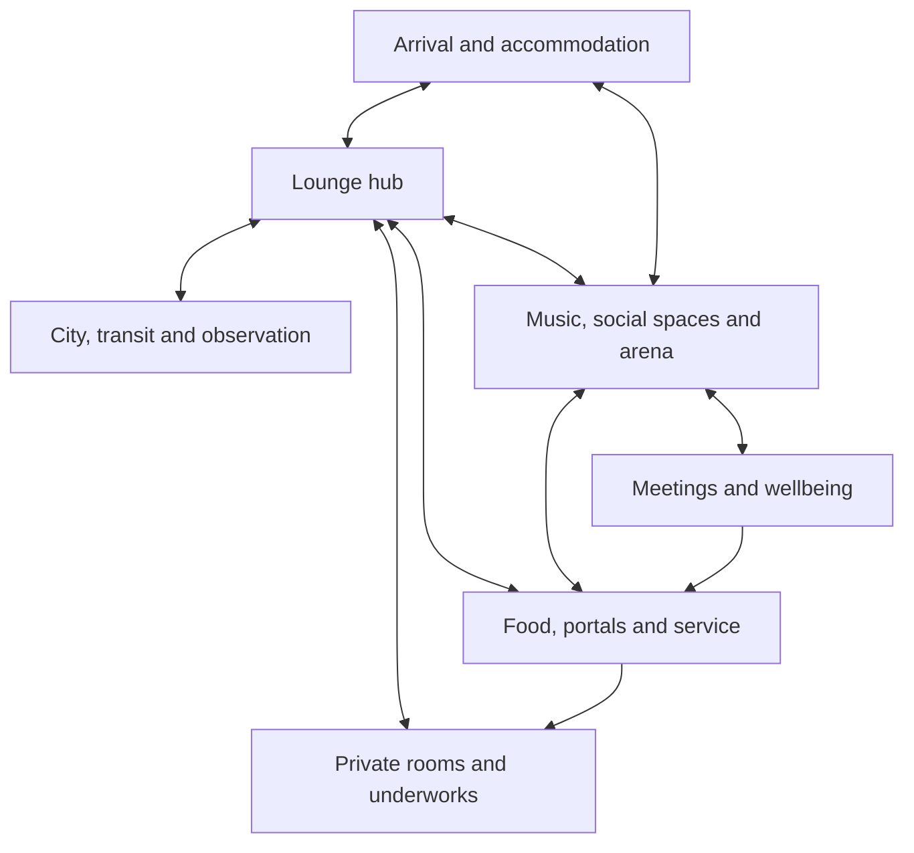

# W2-F2 — The Local Atlas

Home: W2 Worlds. Status: COMPLETE — 43 rooms and 100 directed exits accounted for.
Date: 17 October 2026. Previous: [W2-F1](W2-F1_WHERE_EVERYTHING_IS.md).
Return: [Wing Index](../WING_INDEX.md).

Source: [configured room catalogue](https://github.com/karun777/future-sky/blob/0f9f9ef7b47e7c12a1694b7f8ee101a835dc1c43/data/rooms/rooms.json), pinned at 0f9f9ef7b47e7c12a1694b7f8ee101a835dc1c43.
Live configured file: /opt/futuresky/data/rooms/rooms.json.
Live file SHA-256 rechecked at the start of W2-F2: 20fc12b8573b6716a7453715fb4ee43ab35697ab38d367673d31747a0e3b661b, unchanged from W2-F1. Its exit graph matches the pinned source.

This is a developer atlas, not an in-world map every character possesses. It contains private areas and hidden routes. It is a topological map, not a scale plan. Group headings are editorial navigation aids, not newly adopted canonical regions.

## At a glance

The Lounge hub joins accommodation, the city, private rooms, service routes and the social floor. The social floor also joins accommodation, service/portal areas and wellbeing rooms; service corridors join the private underworks. The city observation loop returns to the Lounge.

The diagram summarises connections between groups. An arrow represents at least one directed room exit across that boundary, not a new room exit or a guaranteed gameplay permission. Exact endpoints and labels are in the room tables.

## Reading the room map

Each row lists **all** outgoing exits of that room: exact command label → destination ID. Use the literal labels, including inside, outside, upstairs and west_up. Arrows do not promise an opposite direction; read the destination row for its actual exits.

**†** marks an exit whose destination has no direct edge back to the source. These four links may be deliberate; no repairs are implied. Indirect return routes still exist.

## Arrival and accommodation (4 rooms)

| Room ID | Exact outgoing exits |
| --- | --- |
| `pod_room` | `west` → `hostel_hallway` |
| `hostel_hallway` | `south` → `lounge_balcony_overlook`; `east` → `pod_room`; `down` → `hostel_stairwell` |
| `hostel_stairwell` | `down` → `neptune_lounge`; `up` → `hostel_hallway`; `west` → `lounge_rest_nook` |
| `lounge_balcony_overlook` | `down` → `lounge_main_floor`; `north` → `hostel_hallway` |

## Lounge hub (2 rooms)

| Room ID | Exact outgoing exits |
| --- | --- |
| `neptune_lounge` | `north` → `main_square`; `up` → `sector_16`; `south` → `sector_48`; `east` → `efiishents_office`; `west` → `kitchen_backline`; `northwest` → `domefront_catwalk`; `inside` → `lounge_main_floor`; `down` → `lounge_portal_zone`; `upstairs` → `hostel_stairwell` |
| `sector_16` | `down` → `neptune_lounge` |

## Music, social spaces and arena (8 rooms)

| Room ID | Exact outgoing exits |
| --- | --- |
| `lounge_main_floor` | `outside` → `neptune_lounge`; `east` → `lounge_games_corner`; `west` → `lounge_dance_floor`; `north` → `lounge_conference_wing`; `south` → `lounge_stardock_overlook`; `up` → `lounge_balcony_overlook` |
| `lounge_dance_floor` | `east` → `lounge_main_floor`; `south` → `lounge_stage_edge` |
| `lounge_stage_edge` | `north` → `lounge_dance_floor`; `west` → `lounge_arena_portal`; `east` → `lounge_main_floor` † |
| `lounge_games_corner` | `west` → `lounge_main_floor`; `north` → `lounge_rest_nook` |
| `lounge_rest_nook` | `south` → `lounge_games_corner`; `west` → `lounge_main_floor` †; `up` → `hostel_stairwell` |
| `lounge_stardock_overlook` | `up` → `lounge_portal_zone`; `north` → `lounge_main_floor` |
| `lounge_arena_portal` | `east` → `lounge_stage_edge`; `down` → `arena_holding_ring` |
| `arena_holding_ring` | `up` → `lounge_arena_portal` |

## Food, portals and service (6 rooms)

| Room ID | Exact outgoing exits |
| --- | --- |
| `kitchen_backline` | `east` → `neptune_lounge`; `north` → `chip_counter`; `down` → `cellar_storage`; `west` → `lounge_service_corridor` |
| `chip_counter` | `south` → `kitchen_backline` |
| `cellar_storage` | `up` → `kitchen_backline` |
| `lounge_portal_zone` | `up` → `neptune_lounge`; `down` → `lounge_stardock_overlook`; `east` → `lounge_service_gate` |
| `lounge_service_gate` | `west` → `lounge_portal_zone`; `east` → `lounge_service_corridor` |
| `lounge_service_corridor` | `west` → `lounge_service_gate`; `east` → `sector_50` †; `south` → `kitchen_backline` |

## Meetings and wellbeing (5 rooms)

| Room ID | Exact outgoing exits |
| --- | --- |
| `lounge_conference_wing` | `south` → `lounge_main_floor`; `north` → `lounge_conference_room_a`; `east` → `lounge_gym` |
| `lounge_conference_room_a` | `south` → `lounge_conference_wing` |
| `lounge_gym` | `west` → `lounge_conference_wing`; `south` → `lounge_pool_level` |
| `lounge_pool_level` | `north` → `lounge_gym`; `east` → `lounge_priest_alcove`; `up` → `lounge_portal_zone` † |
| `lounge_priest_alcove` | `west` → `lounge_pool_level` |

## Private rooms and underworks (10 rooms)

| Room ID | Exact outgoing exits |
| --- | --- |
| `efiishents_office` | `west` → `neptune_lounge`; `east` → `sector_50` |
| `sector_50` | `west` → `efiishents_office`; `east` → `dark_rat_queen_den` |
| `dark_rat_queen_den` | `west` → `sector_50`; `down` → `ratways_01` |
| `ratways_01` | `up` → `dark_rat_queen_den`; `east` → `sewer_access` |
| `sewer_access` | `west` → `ratways_01`; `west_up` → `subjunction_12` |
| `subjunction_12` | `up` → `sector_55`; `east` → `sewer_access` |
| `sector_55` | `north` → `sector_54`; `down` → `subjunction_12`; `west` → `maintenance_hub_03` |
| `sector_54` | `south` → `sector_55` |
| `maintenance_hub_03` | `north` → `sector_48`; `east` → `sector_55` |
| `sector_48` | `north` → `neptune_lounge`; `south` → `maintenance_hub_03` |

## City, transit and observation (8 rooms)

| Room ID | Exact outgoing exits |
| --- | --- |
| `main_square` | `south` → `neptune_lounge`; `up` → `sector_42`; `east` → `dock_gate` |
| `sector_42` | `down` → `main_square` |
| `dock_gate` | `west` → `main_square`; `north` → `transit_pod_bay` |
| `transit_pod_bay` | `south` → `dock_gate`; `west` → `security_checkpoint`; `east` → `observation_dome` |
| `security_checkpoint` | `east` → `transit_pod_bay`; `south` → `holding_cell` |
| `holding_cell` | `north` → `security_checkpoint` |
| `domefront_catwalk` | `southeast` → `neptune_lounge`; `up` → `observation_dome` |
| `observation_dome` | `down` → `domefront_catwalk`; `west` → `transit_pod_bay` |

## Example routes, with exact labels

| From → destination | Route |
| --- | --- |
| Pod → Lounge hub | pod_room — west → hostel_hallway — down → hostel_stairwell — down → neptune_lounge |
| Lounge hub → chips | neptune_lounge — west → kitchen_backline — north → chip_counter |
| Lounge hub → Dark Rat Queen's den | neptune_lounge — east → efiishents_office — east → sector_50 — east → dark_rat_queen_den |
| Lounge hub → dance floor | neptune_lounge — inside → lounge_main_floor — west → lounge_dance_floor |
| Lounge hub → transit bay | neptune_lounge — north → main_square — east → dock_gate — north → transit_pod_bay |

These are static paths, not executed commands. Thread Nodes, identity requirements and other runtime conditions were not exercised.

## Four directed shortcuts

| Source | Label | Destination | Why marked |
| --- | --- | --- | --- |
| `lounge_stage_edge` | `east` | `lounge_main_floor` | No direct return edge |
| `lounge_rest_nook` | `west` | `lounge_main_floor` | No direct return edge |
| `lounge_pool_level` | `up` | `lounge_portal_zone` | No direct return edge |
| `lounge_service_corridor` | `east` | `sector_50` | No direct return edge |

## Scope and verification

All 43 room IDs appear once in the room tables. Every one of the 100 source/direction/destination triples is represented once there; overview and example routes are explanatory duplicates. All targets exist. All 43 rooms are graph-reachable from both the pod and Lounge.

All inspected rooms carry the Manzo era tag. This atlas does not map Jyotzon, Omincron, the whole of Triton Central or destinations mentioned only in prose. It does not resolve physical geometry, the smaller reset baseline, duplicate stores or live in-memory divergence. See W2-F1 for those seams.

Verification: generated tables from the pinned room catalogue, checked group partition and exact edge coverage, compared overview cross-group links to actual exits, verified example routes step by step, and rechecked the live room-file hash before authoring. No gameplay state or service changed.

## Return checkpoint

Reached: source-verified local atlas, exact exit table, room-group overview, sample routes and four one-way links.
Settled: Worlds first pass now has two completed feathers. No geography was changed.
Open: intended geometry/shortcuts, baseline lineage and actual gated player traversal.
W2 is parked after W2-F2. W2-F3 remains unallocated. W3 Beings is the next proposed wing, not yet activated.
