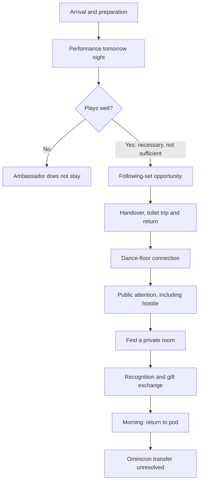

# W4-F3 — Two Days at Neptune Lounge

**Home wing:** W4 Play  
**Status:** REVIEW — authored account preserved and conditional mission map ready; no runtime implementation  
**Allocated / prepared:** 18 October 2026, Australia/Perth  
**Linked wings:** W1 Mythos, W2 Worlds, W3 Beings, W5 Time, W6 Expression, W8 Stewardship  
**Source baseline:** main `fa7d751d5b4bfcba714772d526a60eea38ee5694`  
**Return:** [Wing Index](../WING_INDEX.md)

**Read first:** [Awakening — the connected reconstruction](../handover/AWAKENING_RECONSTRUCTION_20261018.md), with [Karun's words](../handover/AUTHORIAL_NOTES_20261018.md) and the [source/logic review](../handover/AWAKENING_SOURCE_REVIEW_20261018.md). This map is the analytical companion.

## One feather

Preserve Karun's Chapter 1 / Timeline 1 account and map its conditions, deadlines, missed opportunities, participant knowledge and lasting evidence. Distinguish author-specified facts from open mechanics. Do not invent alternative winning routes, numeric thresholds or a new scenario engine.

This map describes narrative logic. A diagram or review case below is not proof of functioning multiplayer logic. Larger World Engine expansion remains on hold.

## Source key

All S references below identify Karun's messages in this conversation on **18 October 2026**, Perth time:

- **S1 — 12:40:** detailed pod, character creation, existential spy, work/casual gear and jobs/factions direction.
- **S2 — 13:41:** Chapter 1 / Timeline 1, Efiishent's passage, Earthdance, performance, princess, exchange, return, persistent evidence and real-world receipt condition.
- **S3 — 14:00:** two-day window, ordered beats, missed timing, possible repeat cycle, recurring other princes/princesses and future human participants in currently NPC roles.
- **S4 — 14:16:** a different princess's physical gift; distinct from the Dark Rat Queen's gift.
- **S7 — 17:05:** Omincron earthly-life specificity; Earthdance 2024 portal; ambassador/princess/Queen identity; common diplomatic-trade quest, optional romance, future particular Puzzler/Queen instances and privacy paramount.
- **S6 — 14:55 and 14:59:** explicit preserved-brain canon, gradual reintegration, seven-day/manual qualification and corrected population. See the [canon note](../current/MANZO_PRESERVED_BRAINS_AND_AWAKENING.md).
- **S5 — 14:19:** Karun authorises W4-F3 as proposed: documentary preservation and logic mapping, not runtime implementation.

These are source pointers into the conversation, not invented external citations. The account below is a faithful structured rendering, not a verbatim transcript. Assistant suggestions are not silently promoted into S1–S4.

## Common quest and instance scope — clarified 17:05

Any player can undertake the mission to meet a representative from an allied faction at Neptune Lounge and make a trade. Romance is possible but not necessary. The Puzzler was an illustration of that general availability; the Puzzler's and the Dark Rat Queen's particular quest instances will be authored later.

Efiishent's musical performance, bodily interruption, romantic meeting and particular gift exchange are his authored instance. The performance gate, private-room sequence and IRL relevance condition are not universal prerequisites for every participant's version.

In Efiishent's instance, **ambassador = sadvipran alien embassy representative = princess = Dark Rat Queen**. This relationship is settled, while its in-world disclosure remains constrained.

All quests leave a footprint; privacy is paramount. A durable occurrence is not automatically a public or identity-revealing trace. See [the reconstruction's privacy treatment](../handover/AWAKENING_RECONSTRUCTION_20261018.md#footprints-with-privacy-paramount).

## 1. The story to preserve — Efiishent's account (S2)

Other versions of Chapter 1, “Awakening,” will exist on other timelines. This account is **Timeline 1**, whose relationship to earlier A–G labels is not established.

Karun tells the mission through Efiishent's lived perspective. Efiishent does not know whether what he is living is real. Nevertheless, within the authored world, events happen and leave logic, evidence, artefacts, records and clues. Completing the quest need not make the accomplishment publicly known. Deeply curious participants may find buried traces.

Efiishent has come from Omincron through a portal he stepped through at Earthdance 2024 in the Omincron era. He is to meet a sadvipran alien embassy representative concerning a gift. That ambassador is the princess and the Dark Rat Queen in this instance. Vitriol's agents are trying to intercept it. The phrase “which he needs to get from Omincron” is preserved as an unresolved direction-of-transfer statement; later in the same account he needs to take the received item back to Omincron.

He awakens in a pod, not remembering and not necessarily motivated to recover his memory. Karun's later canon clarification explains retained memory without immediate access: preserved-brain rebirth requires gradual reintegration. Usually seven days, qualified by reading an instruction manual none is known to possess; exact mechanics remain open. He has a gig tomorrow night. He does not know whether it is a DJ set, for which he has no prepared set, or a live acoustic performance, which instrument it would involve, whether he can play it, whether he has collaborators, who plays before him, or who has come to see him. Fairly early, he learns that he must meet someone after his performance.

Unknown to him, if he does not play well, the ambassador will not remain for the following set. His set must build the atmosphere for the next artist and he must hand over smoothly. He urgently needs the toilet and wonders whether he has a bladder issue. He gets there and back, returns to the dance floor and contributes to its energy during a stagnant transition. The following artist is playing exceptionally well.

He enters peak flow. A princess arrives, attractive and vividly engaged in the music. They quietly connect and gradually enter a shared resonant flow with others. The energy they hold together becomes publicly noticeable. People are moved and drawn into it; sinister observers notice too.

Efiishent and the princess become aware of these forces. They cannot make the exchange on the dance floor. Each is uncertain who the other is while feeling completely sure. They seek a room, both somewhat overwhelmed by their faculties, believing they have been discreet.

In the excitement they make love. Afterwards they reveal what they know of one another. Efiishent gives her a Tiny Book; she gives him her gift. They sleep in one another's arms.

The next morning he must return to the pod and work out what to do with the item, including how to get it back to Omincron.

**Author-level identity:** the princess is the Dark Rat Queen. No one but Efiishent can know that identity connection; discovery by Vitriol's agents endangers her life. This is an **in-world knowledge constraint**, not an instruction to restrict repository access.

Karun specifies that the item only truly has relevance or meaning if Efiishent receives it from her **IRL**. Record this as an authorial relevance condition; an in-game inventory change cannot certify a real-world encounter or receipt.

The Chapter 1 final boss has been mentioned as conceived but **has not been identified**. Do not assign that role to Vitriol, the princess or anyone else by inference.

## 2. Things that must remain separate

| Distinction | Rule for this map | Source |
| --- | --- | --- |
| Occurrence / credit | An event has a definite occurrence even when who “kicked the goal” is unresolved to people. Ambiguous attribution does not erase world truth. | S2 |
| Efiishent / another participant | The Puzzler can attempt the same quest and encounter traces of Efiishent's earlier attempt. The common allied-representative meeting/trade quest is available to any player; individual routes and contributions are authored instances. | S2 |
| Particular / recurring encounter | Efiishent's Dark Rat Queen encounter is particular to him. Other participants do not repeat that relationship by replaying the chapter. | S3 |
| Other royalty / Queen | Other princes/princesses visit nightly looking to hook up and exchange gifts with Earth hotties. Their individual identities and intentions are not automatically the Queen's; romance is optional in the common quest. | S3 |
| Gift / mission item | A gift with unclear significance can matter without fulfilling this mission. The photographed feather ornament is explicitly another gift. | S4; [gift record](../current/items/PRINCESS_FEATHER_GIFT_20261018.md) |
| Job / faction / clothes | Jobs and factions differ; cleaners and spies can exist across factions. An outfit is not proof of employment, allegiance or competence. | S1; last sentence is a modelling distinction for review |
| Character / Role / Driver | A participant may later fill a role currently run by a scripted character. Preserve identity, knowledge and continuity; do not assume current driver-transfer capability. | S3; [ontology](../current/ARCHITECTURE_v1.1.md), [W3-F2](W3-F2_WHO_CARRIES_WHOM.md) |
| World / belief / record | Store or author what happened separately from who observed it, what they concluded and which traces survive. | S2; modelling requirement |
| Real-world receipt / fictional receipt | Neither an in-game item nor a fictional claim verifies physical receipt. Preserve reported provenance and uncertainty. | S2, S4 |

Recovered prior author notes explicitly describe a rat-sized Tiny Book to give the Queen, placed in Efiishent's office/quarters. The live item definition and gifting callback corroborate that strand. This is a concrete continuity lead, rather than an empty placeholder; exact item custody and its role in this particular exchange still need alignment.

## 3. Time: relative constraints, not invented timestamps

**Authored field:** a two-day window. “Tomorrow night” locates the gig relative to awakening; “following set,” “after playing” and “next morning” provide order. Exact opening/closing instants and clock scale are not supplied.

| Boundary | What is specified | What is not settled |
| --- | --- | --- |
| Window opens | Arrival/awakening begins the described passage. | Global session start versus individual entry time; late joining. |
| Before performance | Orientation, realisation, preparation and growing pressure. | Duration and which preparations are strictly necessary. |
| Performance | Tomorrow night; quality affects whether the ambassador stays. | Start/end time and what “plays well” means. |
| Handover and next set | Smooth handover, toilet trip and return; transition gives way to flow. | Exact latest return, travel time and tolerance for interruption. |
| Meeting and exchange | Conditions converge after the performance; public exchange is unsafe/unavailable in this account. | Appointment deadline, private room availability and interception triggers. |
| Next morning | Wake together; return to pod and work out the item. | Whether this morning falls inside the nominal two-day window or is its aftermath. |
| Window closes | If a required thing does not happen in time, that opportunity cannot happen in that window. | A precise 48-hour cutoff, inclusivity at the boundary and consequences for each missed beat. |
| Repeat | Chapter **could** loop every two days; other royalty visit nightly. | Loop is a candidate, not settled. Reset scope, retained memories, state and traces. Nightly attendance is not identical to a two-day mission repeat. |

Do not turn this into two real-world days, two 24-hour world days or the current Manzo clock multiplier without an explicit time decision. Do not force the next morning inside an arbitrarily chosen 48-hour interval.

## 4. Conditional mission map

This is the dependency spine of **Efiishent's described passage**, not a declaration that all listed acts are universal quest gates. Exact predicates wait for authoring.

**IRL receipt is a separate relevance condition**, not an automatic arrow from L. Successful performance does not by itself guarantee attraction, identification, privacy or an exchange.

| Beat | Authored condition or relationship | Opportunity if missed / blocked | Knowledge and possible evidence boundary |
| --- | --- | --- | --- |
| Arrival / orientation | Disoriented awakening; preparation in pod. | Early-exit policy is open; not a proven quest failure. | Character knowledge limited; pod traces need actual authoring. |
| Realisation | Learns early that a meeting follows the gig. | How the message is discovered, and alternatives if missed, unspecified. | Knowing a meeting is due is not knowing the princess's identity. |
| Pressure / preparation | Unprepared performance form, instrument, ability and collaborators are questions. | No invented equipment/class checklist yet. | Schedules, instruments or messages are potential clue types, not already placed props. |
| Performance | Poor performance → ambassador does not remain for the next set. | This following-set opportunity is lost under the stated condition. No invented alternate solution. | Quality criterion and observers unspecified. “Good” is not a numeric vibe score. |
| Handover | Build atmosphere for following artist and transition smoothly. | Consequence of a poor handover is not separately supplied. | Preserve as authored passage; do not conflate with the explicit quality gate. |
| Toilet / return | Bodily urgency; leave and return to the floor. | Late-return cutoff and medical explanation unknown. | Do not diagnose a bladder condition or require every other player to reproduce it. |
| Meet / flow | Mutual connection amid wider participation; conspicuous energy attracts attention. | Failure to connect or counterpart departure closes possibilities only as later authored. | Other people can notice the pair without knowing identity or mission. |
| Privacy | Awareness of sinister forces prevents exchange on the floor; seek room. | No public exchange in this described situation. No invented combat escape or disguise solution. | Belief in discretion is not proof of no surveillance. |
| Intimacy / disclosure | In the account, intimacy precedes revealing what they know. | No claim that sex is a universal mission requirement, reward, or compulsory action for other players. | Keep this particular relationship distinct from generic repeatable encounters. |
| Exchange | Tiny Book outward; princess's gift inward. | Item identity, unique custody and interruption outcomes unresolved. | Knowing an exchange occurred does not imply knowing contents or royal identity. |
| Return | Next morning return to pod; work out item and Omincron transfer. | Return deadline and failure result not supplied. | Having an item does not mean understanding or completing its significance. |
| IRL relevance | Karun specifies receipt from her IRL as necessary for the item's true relevance/meaning. | In-game completion alone does not satisfy it. | How receipt is acknowledged remains open; no surveillance or automatic verification inferred. |

## 5. Intersecting players and a world that remembers

S2 allows another participant to undertake the same quest, including later seeing traces. S3 also envisages participants present in the same period, converging at one moment.

For a later implementation, distinguish:

- **One occurrence shared by witnesses**, from separate look-alike occurrences.
- **Participant-specific actions and knowledge**, from the shared physical situation.
- **Encounter availability**, from ownership or guaranteed access.
- **A gift transfer**, from another participant merely observing or interpreting it.
- **A completed attempt**, from the public attribution of success.

These are requirements for the model, not new database fields adopted here.

### Three passages to keep distinct

| Passage | What can be mapped now | What must not be invented |
| --- | --- | --- |
| Efiishent's particular passage | S2 sequence and named identity secret. | Rewrite into a generic romance reward loop. |
| Puzzler after Efiishent | Existing world contains traces of the earlier attempt; Puzzler's attempt is real too. | Repeat the same unique Queen exchange or erase the earlier event. Puzzler's specific instance will be authored later; the common meeting/trade mission is available. |
| Two participants at one moment | They can share performance/dance-floor context and witness different things. | Automatic shared victory, identical knowledge, duplicated unique gifts or a rule that one participant must lose. |

The earlier assistant suggestion that helping an artist automatically substitutes for performing is **not authored** and is not a valid alternate route in this map.

### Evidence, without counterfeit clues

Karun supplies **the existence of lasting evidence**, not its final placement. An evidence record should eventually distinguish the originating occurrence, physical/recorded trace, who can encounter it, what it shows and what it does not establish.

A schedule, mark, witness memory or receipt could serve later, but none is placed here merely to fill the table. Privacy governs who may discover a trace and what it reveals: curiosity alone does not authorise access to private identity, intimacy, conversation or gift contents. All quests leave a footprint without requiring a public completion feed. A reset cannot silently delete evidence required by the authored persistent-world premise.

## 6. Knowledge boundary at the identity secret

**Fact at author level:** princess = Dark Rat Queen in Efiishent's particular encounter.

**Efiishent:** uncertain recognition before disclosure; account later gives knowledge of who she is.

**Other participants / ordinary witnesses:** can see public connection and react without access to that identity connection.

**Vitriol's agents:** notice something consequential; this alone does not mean they know her identity. If they learn the connection, her life is in danger. No automatic death or deterministic combat outcome is specified.

How she presents herself, what she knows of Efiishent, which disclosure exposes her and whether anyone can discover the secret later remain to be authored. Do not broadcast author-level labels through player UI, generic quest summaries or another participant's private knowledge. This is narrative perspective control, not repository secrecy.

## 7. Repeat windows and future human-driven roles

The two-day repeat is provisional. The nightly prince/princess opportunity and Efiishent's unique encounter cannot simply share one reset button.

Before implementation, resolve separately what resets for: room condition, appointments, participant preparation, gift custody, relationship memory, completed exchanges and discoverable traces. A new cycle opening does not imply that prior events never happened.

Future human occupancy of roles is a desired horizon (S3), not part of this feather. The [existing identity/role/driver distinctions](W3-F2_WHO_CARRIES_WHOM.md) supply the conceptual boundary: preserve knowledge and commitments, and never attribute a scripted decision to an absent human.

## 8. Pod preparation carried forward from S1

The [pod preparation addendum](W2-F3_POD_PREPARATION_AND_WORK_GARMENTS.md) preserves the design decisions behind this mission: local depth, basic character creation before ordinary departure, existential-spy outfitting, work garments and casual gear, and jobs distinct from factions. It is linked back to W2-F3, which stays in REVIEW.

The pod supplies preparation and instruction through investigation. Its exit rules are not decided by the mission map. Clothing does not choose the quest's winner.

## 9. Review cases — logical checks, not executed tests

| Case | Expected conclusion from current sources | Status |
| --- | --- | --- |
| Poor set | Ambassador does not stay for following set. | Determinate from S2. |
| Good set, no meeting | Cannot infer an exchange or mission completion from performance alone. | Determinate: sufficiency not supplied. |
| Performance good, handover poor | Must not invent a pass/fail result. | Open authoring decision. |
| Returns after counterpart leaves | Missed opportunity cannot be retroactively taken within that occurrence. | General deadline rule S3; exact leave boundary open. |
| Exchange attempted publicly under described threat | Cannot complete that exchange on the dance floor in this account. | Determinate from S2. |
| Witness sees the pair | Witness does not automatically learn Queen identity or gift contents. | Knowledge boundary. |
| Puzzler arrives later | Earlier evidence persists; Queen encounter not automatically reproduced. | S2/S3; concrete route/trace unspecified. |
| Two participants converge | One shared event can have different perspectives; outcome allocation unresolved. | Requirement, not runtime proof. |
| Second two-day cycle | Cannot erase unique encounter or retained evidence by assumption. | Reset policy open. |
| Fictional item received, no IRL receipt | Cannot claim Karun's relevance condition has been met. | S2. |
| Other princess gives feather ornament | Do not substitute it for Queen gift or mark mission complete. | S4. |
| Chapter final boss | Unknown. | Not named by Karun yet. |

Checked: all declared mission conditions trace to S1–S4; assistant inferences are labelled; unsupported deadlines, alternate wins, scoring and item powers are absent. Markdown links are verified against the repository tree. No code tests are claimed or needed for this documentary map.

## 10. Return checkpoint

Reached: account preserved, relative time boundaries mapped, one explicit performance-loss condition distinguished from open dependencies, unique/recurring encounters separated, shared reality and knowledge constrained, review cases recorded.

Open: exact window bounds and next-morning placement; time scale; gig format and performance criterion; discovery of appointment; item identity and transfer direction; final boss; other valid routes; shared outcome/custody; reset retention; IRL receipt acknowledgement. Do not demand all answers at once.

**Return after reconstruction:** review the connected opening as an experience, including what makes tomorrow's gig discoverable during preparation. The ambassador's stay/leave boundary and performance criterion remain the first explicit mission gate to define when that scene is developed; no numeric quality system is selected.

W4-F3 remains in REVIEW. W4 completed count stays 2; total completed wing feathers stays 16. W2-F3 is parked in REVIEW, W1-F3 / Feather 57 stays parked. No runtime, live data, service, clock or deployment changes; on-host documentation availability is not claimed.

## Reconnected review — 18 October 2026

The source and lived account have been reread in a [connected reconstruction](../handover/AWAKENING_RECONSTRUCTION_20261018.md). An [offline authoring rehearsal](../../tools/authoring/chapter_one_rehearsal.py), with [23 passing boundary cases](../../tools/authoring/test_chapter_one_rehearsal.py), now demonstrates supplied-fact deadlines, separate perspectives, gift custody and example retained traces. Its synthetic timing and reset policy are not live rules. No production code imports it. Author review and actual gameplay integration remain pending.
