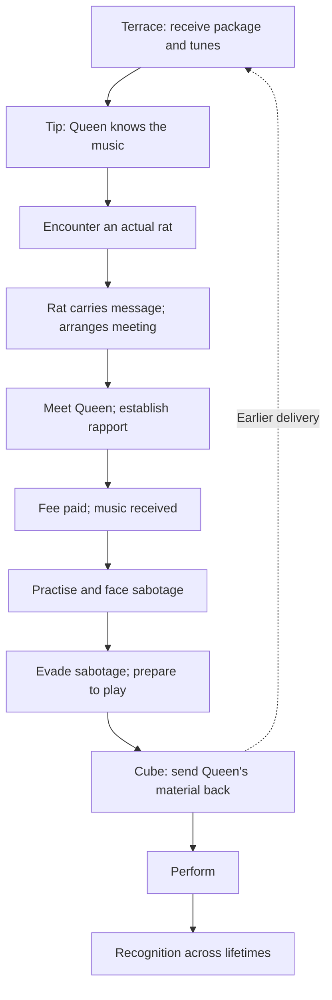

# W4-F9 — Music, custody and conditions

Status: **REVIEW DRAFT — narrative dependency map, not runtime rules.**  
Home: [W4-F9 — What Am I Playing Tomorrow?](W4-F9_WHAT_AM_I_PLAYING_TOMORROW.md)  
Prepared: 22 October 2026, Australia/Perth.  
Source checkpoint: 0cbe03d plus Karun's subsequent author statements in this conversation.  
One feather; W4 seven sealed, twenty-three total. No completion increment.

## Author decisions recovered

The following are Karun's direction, not assistant extrapolation:

1. Encounters need conditions. Code must allow the tunes to vanish from inventory if Efiishent fails to do what he needs next; the exact failure boundary is not yet conceptualised.
2. A tip, from an undecided source, says the Dark Rat Queen knows the princess's musical taste.
3. The tip leads to an encounter with an actual rat. The rat carries a message to the Dark Rat Queen and arranges a meeting. At the later Queen meeting he establishes rapport, pays her fee and receives the tunes. He practises, performs and recognises that Queen and princess are the same person. The messenger rat is a distinct being, not the Queen in rat form.
4. Vitriol tries to steal, swap or corrupt the USB data before the performance. A direct encounter follows with Vitriol or an important agent. Exact attempts and antagonist identity remain open.
5. The relationship's recognition has the “Piña Colada Song” quality across several lifetimes. This is a thematic analogy, not a request to use the actual song or implement a prescribed romance. How much either person remembers is open.
6. **He must send what he receives from the Dark Rat Queen back to himself.** It is a Cube power. This is the last thing he does before actually playing, after evading the sabotage attempt(s).
7. Karun explicitly wants space to think further. The sequence is usable direction; physical and causal rules are not fully settled.

This supersedes the initial W4-F9 draft's uncertainty over whether the later self sends the music. It does not settle whether an identical physical USB, its data, the antique box or a copy is sent.

## Connected passage

The terrace receipt occurs earlier in Efiishent's experience than the Queen meeting and the Cube send. The backward delivery connection must be kept separate from the order in which he experiences events.

Practice and sabotage sit in the pre-performance passage; their exact ordering/interleaving is not fixed. The tip's timing relative to the terrace receipt is not expressly fixed either; its diagram position is a workable reading, not a gate requiring he remain ignorant before delivery. Recognition's precise scene remains open, subject to the existing W4-F3 dance-floor/private-disclosure account.

## Conditions by beat

| Beat | Established requirement | Proposed encoding/selection, not adopted | Still open |
| --- | --- | --- | --- |
| Terrace approach | The particular performance-arrival passage; outdoor view and music concern | Known booking + terrace presence + authored attention action + delivery not already received | Exact trigger, timing, scenario enrolment and habitability |
| Delivery arrival | Warm addressed package; wrapping burns away; antique locked box | Record occurrence once, separately from pickup; show no sender | Address recognition and availability if he leaves |
| Box opening | Neck key opens the antique box; tunes USB inside | Separate pickup, wrapper-open and key-use interactions | Inventory representation/key custody; scope across other players |
| Tip | Someone points him to the Queen's knowledge | Character learns the lead only when actually told | Who, where, cost/conditions, precise timing |
| Rat encounter | Tip leads to an actual rat, distinct from the Queen | Record finding the messenger separately from access to the Queen | Rat personality, communication, encounter place and how contact succeeds |
| Message and arrangement | Rat carries a message to the Queen and arranges a meeting | Record message entrusted, delivery and meeting arrangement separately; the player learns only what is communicated | Message content, acknowledgement, meeting place/time and changes/cancellation |
| Queen meeting | Meet her, establish rapport, pay fee, receive music | Meeting arranged is not meeting attended; record rapport, payment and receipt independently | Rapport actions, fee and currency |
| Practice | He practises before playing | Record actual preparation, not possession alone | What music/equipment he practises with; criterion and timing |
| Sabotage | Attempt(s) to steal, swap or corrupt; direct antagonist encounter before playing | Record attempts and their actual outcomes; preserve prior state on failed saves | Antagonist, tactics, evasion/recovery choices and what counts as resolved |
| Cube send | Send Queen-received material to earlier self, after evading sabotage, immediately before playing | Verify material/provenance and chosen destination; persist once before reporting success | Medium/copy, Cube access/action, payload validation, packaging and exact temporal address |
| Performance | Playing required in this particular pathway; quality matters to ambassador staying | Use actual available payload and preparation; do not infer quality from inventory | Equipment, format, quality rule and outfit consequence |
| Recognition | Queen and princess are the same person; resonance across lifetimes | Character knowledge changes through authored experience/disclosure | Who remembers what/when, outward forms and witnesses |
| Tunes vanish | Must support consequence if required later actions fail | Mark temporal validity separately from possession and record disappearance | Exact failure trigger, deadline, affected object/data/copies and recovery policy |

The proposed terrace conjunction is a bounded implementation candidate, not a list of author-approved universal prerequisites. Class choice alone does not imply this particular history. Brass token, performance-tab spending, alcohol, clothing and the act of smoking have not been adopted as delivery gates. Smoking is in Efiishent's authored passage; reusable alternatives for lingering remain proposals.

Do not make the terrace wait for the future send to be completed in the runtime: that would deadlock this narrative. Initial receipt needs to be representable before its later cause is fulfilled.

## Custody and provenance: two observations, not two invented objects

Use **earlier material** and **Queen-received material** as analytical labels. They do not decide whether one physical object has two overlapping ages or two different media carry the same music.

| Point | Material involved | What is known to happen | What cannot yet be asserted |
| --- | --- | --- | --- |
| Terrace receipt | Package → antique box → USB marked tunes | Efiishent encounters the earlier delivery | Who prepared it; whether he knows contents, sender or connection |
| After opening | Earlier USB/data | Something may be carried, examined or used | Immediate playable readiness, equipment, duplication or immutability |
| Queen receipt | What the Queen supplies | After rapport and fee, he receives the tunes | Same physical USB, a new USB, transferred files, or exact equality with earlier data |
| Sabotage passage | The USB/data under attack | Theft, swap and corruption are distinct possibilities | Which temporal version is attacked; whether attackers know the loop |
| Cube send | Queen-received material | Sent back to the terrace moment | Whether it leaves his hand, is copied, is transformed or includes the box |
| Immediately after send | Performance material | He is about to play | Which medium remains, whether music has been loaded, and how he accesses it |
| Failure consequence | Earlier dependent tunes | Must be able to vanish on the eventual authored failure | Delete all USBs, remove only files, erase memory, retroactively erase the receipt, or undo another person's inventory |

The central practical question is **what he performs from after the send**. Receiving an earlier version could provide a path, but overlapping custody, stored copies and playback preparation need authoring rather than an automatic copying mechanic.

The neck key and wooden cube in pod prose, the personal Cube shown by !cube, THE Cube and the delivery power must not be equated merely because their labels resemble one another. Which expression of the Cube he uses is open.

## Four independent things to remember

Proposed state responsibilities, not adopted schema:

- **Occurrences:** package landed, Queen encounter happened, fee was paid, attempted theft, send completed. Later disappearance does not mean the earlier event was never experienced.
- **Custody:** who/what holds a particular medium now—bag, ground, locker, another character or shipment.
- **Content and temporal validity:** original, substituted or corrupted data is distinct from a still-provisional causal link. An intact payload could become temporally invalid; a closed loop need not repair corrupted data automatically.
- **Knowledge:** what each character observed and concluded. Knowing a name, having the music or seeing the princess does not automatically grant the identity connection.

Potential labels such as provisional, fulfilled and invalidated describe an implementation option, not a newly adopted metaphysics or countdown.

## Theft, substitution, corruption and temporal loss

| Change | Possession | Content | Cause/evidence |
| --- | --- | --- | --- |
| Theft | Holder changes | Could remain intact | An actual taking; recovery can be meaningful |
| Substitution | A medium may remain in the bag | Different payload | Swapped identity/content, discoverability to author |
| Corruption | Medium may remain | Damaged or altered | Integrity loss; no automatic repair |
| Temporal invalidation | Effect on holder/content still to be chosen | Dependent tunes cease to be available as authored | Required future action failed at an authored boundary |

A count under one generic tunes item key cannot express all these differences. Likewise, removing the first matching USB from a bag could destroy an unrelated item and leave the dependent object in a locker.

Requirements for eventual implementation: identify the dependent material and its lineage; inspect all permitted custody paths; apply one durable consequence; preserve unrelated possessions and historical occurrences; report success only after persistence. If transfer/copy support cannot carry that identity, resolve that boundary before enabling those operations. No arbitrary blanket deletion.

No deadline is invented here. Ordinary logout, a slow response, a failed disk write or an ambiguous event is not proof of narrative failure. Whether world time continues through absence must be decided with the authored opportunity window.

## Identity and relationship boundaries

The princess/Queen relationship is established at author level. The public presence list showing “The Dark Rat Queen” is a presentation risk to inspect, not by itself proof that the princess's identity link has been disclosed. Her visible form, recognised name and the connection between identities need contextual presentation.

The Queen's fee purchases the agreed musical service/material; it does not buy affection or consent. Learning taste or playing music can create recognition/opportunity without an automatic romance reward. Reuse W4-F3's privacy and performance constraints. Do not turn bar credit into her fee currency without author direction.

The theme spans lifetimes, but neither an exact count nor a prescribed prior relationship history has been supplied. Earlier assistant language about shared past encoded in specific songs was interpretive possibility, not settled authored content.

## What the cogs currently support — source inspection, 22 October

| Area | Verified source capability | Boundary for W4-F9 |
| --- | --- | --- |
| Navigation | Persists movement and emits character.entered_room; W4-F8 route played live | New terrace and attention/delivery conditions not built |
| Inspection | Local knowledge-dependent scenes and persisted discoveries; prior live checks | No package/box/key/USB interactions yet |
| Bar and performance tab | Persisted receipt/balance, one-time grant and spending; played live | Does not model Queen rapport, fee, practice or a music payload |
| ScenarioEngineCog / ScenarioService | Room-event bridge to portal_run; variables, flags and factual history in memory | Not durable across restart; not an existing causal-loop authority |
| CubesCog | Inspect/ensure personal Cube and prime Cube via storage | No addressed backward delivery action |
| ItemTransferCog / transfer | Bag/ground movement by catalogue ID/count and room item names | No instance identity/temporal lineage; two-store persistence is not a proven atomic transaction |
| GiftingCog | Character-to-character gift persistence and room/name checks | Needs lineage treatment before dependent music can move safely |
| Existing event/history pipeline | Architectural support for facts and records | No verified W4-F9 event chain or replay behaviour yet |

Inspected live ScenarioEngineCog and ItemTransferCog match this branch byte-for-byte. Live CubesCog differs in raw bytes only: normalised text was verified equal, reflecting its CRLF/LF line endings. Live scenarios.py explicitly declares in-memory state and one hard-coded portal_run scenario.

This mapping answers which cogs can contribute. It does not claim the new encounter chain works because the cogs are loaded.

## Review cases — specification checks, not executed tests

| Case | Expected requirement / unresolved result |
| --- | --- |
| Ordinary arrival or class selected without booking | No accidental grant of Efiishent's particular delivery |
| Terrace reached twice | No duplicate occurrence/package from re-entry |
| Package lands, player leaves before pickup | Occurrence retained; availability/custody policy to author |
| No name recognition | Address remains readable without imposed autobiographical memory |
| Rapport but no fee paid | Do not assert music received; exact negotiation path open |
| Fee payment save fails | No lost fee or success claim; retry must not duplicate material |
| Theft succeeds then object recovered | Custody changes distinguishable from corruption/invalidation |
| Swap or corruption unnoticed | Do not silently substitute “correct music” in performance |
| Cube send retried after reconnect | No duplicated delivery or material consumption |
| Tunes stored/gifted before failure | Lineage consequence must follow authored material, not only original bag |
| Player does not send | Support disappearing tunes, but no chosen trigger or deadline yet |
| Player sends after evading sabotage | Final preparation action before performance; material availability still to settle |
| Restart mid-sequence | No loss of actual encounter/payment/custody/knowledge or duplicate scene |
| Rat takes a message | Do not assert it is delivered, a meeting attended or a fee paid merely because it was entrusted |
| Meeting arranged | No music, rapport or Queen/princess identity knowledge granted automatically |
| Rat encounter and Queen encounter | Distinct beings and occurrences; rat is not a disguised Queen |
| Witness sees messenger rat and princess separately | No inferred identity equivalence; rat remains the intermediary |

## Next bounded return

This map is ready for author review. The first useful decision is **which music remains available to perform after the Queen-received material is sent**. Closely related: physical USB versus music data as the dependent thing. The failure boundary can be settled once these are clear.

Do not implement a full timeline engine, irreversible invalidation or automatic inventory deletion from this map. A later isolated rehearsal can use explicitly synthetic choices to verify branching/custody before any runtime change. W4-F9 remains active; no room, item, character, service or world-clock changes.

## Rat intermediary clarification — 22 October 2026

Karun explicitly distinguishes an actual rat from the Dark Rat Queen. The tip leads to that rat; it carries a message to her and arranges a meeting. Details can be fleshed out later. This supersedes any earlier ambiguity about a rat-form Queen encounter, including the earlier review-case wording. The Queen/princess identity connection remains unchanged.

For eventual coding, preserve separate facts: messenger encountered, message entrusted, message delivered, meeting arranged, arrangement learned and meeting attended. These are proposed tracking distinctions, not six mandatory clicks or an adopted database schema. Do not show off-screen delivery as character knowledge before an acknowledgement or other authored evidence. No rapport score, rat speech method, messenger fee, appointment deadline or live enemy-rat identity selected. Existing sewer cyber-rat enemies are not silently made this messenger.

This documentary update leaves personality, dialogue, location, acknowledgement and meeting logistics open. It does not implement rat behaviour or grant music.
